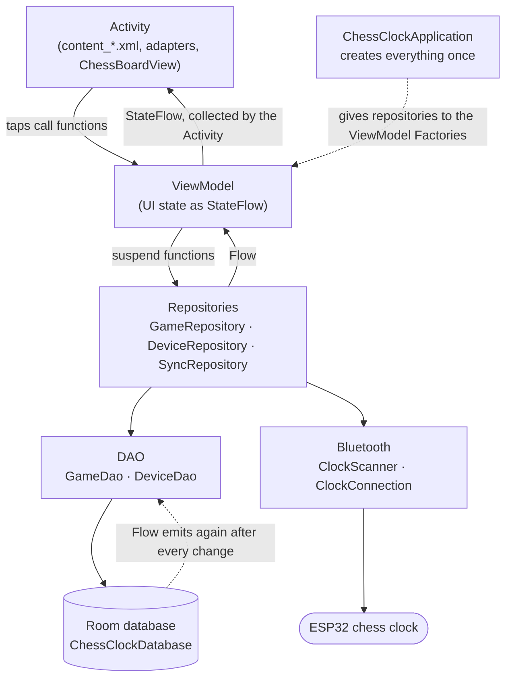
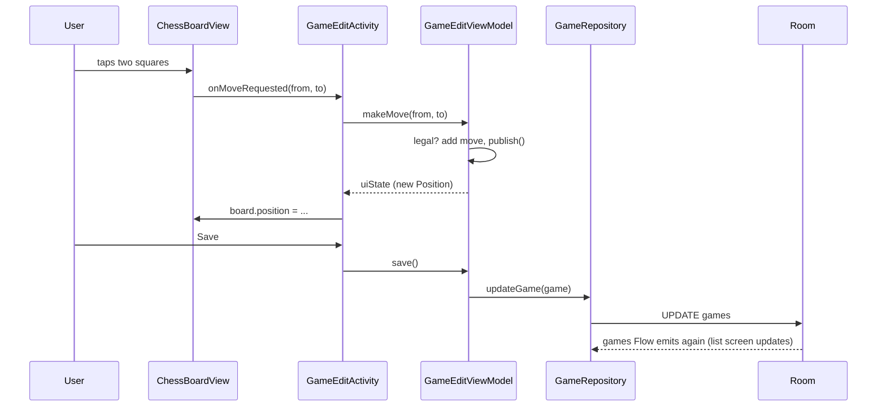
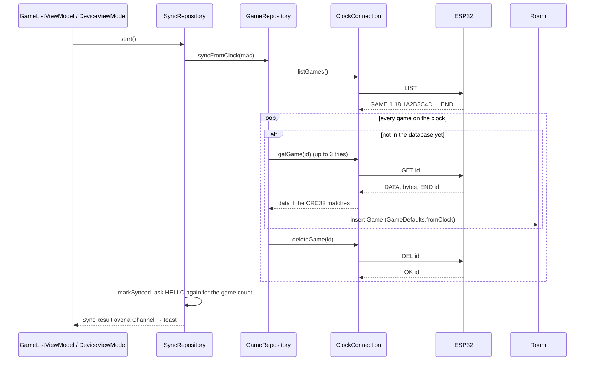

# Chess Clock with an app

A chess clock built on an ESP32, and an Android app (Kotlin) that goes with it.

The clock records how much time is left after every half-move. The app connects to the clock over
Bluetooth, copies those games to the phone and turns them into PGN. The clock does not know which
moves were played, so the user enters them on a chess board in the app. The clock times are kept
next to each move.

## Contents

1. [Repository layout](#1-repository-layout)
2. [Building and running](#2-building-and-running)
3. [Package structure](#3-package-structure)
4. [How the layers work together](#4-how-the-layers-work-together)
5. [Flow of execution](#5-flow-of-execution)
6. [Lifecycle](#6-lifecycle)
7. [Bluetooth protocol](#7-bluetooth-protocol)
8. [Design decisions](#8-design-decisions)
9. [Known limitations](#9-known-limitations)

---

## 1. Repository layout

```
app/                                  Android app (Gradle project, open this folder in Android Studio)
  app/src/main/java/.../chess_clock_app/   Kotlin code, see section 3
  app/src/main/res/                         layouts, strings, colors, icons
  app/src/test/                             unit tests (chess rules)
firmware/
  chess_clock_esp32.ino               the clock itself: displays, buttons, hall sensor, timing, settings
  bt_pairing_test/bt_pairing_test.ino prototype of the game transfer, the protocol the app speaks
  BT/BT.ino                           Bluetooth serial echo test
```

The clock firmware (`chess_clock_esp32.ino`) runs the game: two TM1637 displays, the buttons, a hall
sensor with calibration to switch players, battery reading, and settings stored with `Preferences`.
Moving games to the app is not part of it yet. `bt_pairing_test.ino` is where the transfer was built
and tested: it holds 2 hardcoded games and answers the app exactly like the real clock should later.

## 2. Building and running

**App**
- Android Studio, open the `app/` folder.
- minSdk 26 (Android 8), targetSdk / compileSdk 37, Java 11.
- Libraries: AppCompat, Material, RecyclerView, DrawerLayout, Room (code generated with KSP),
  Lifecycle (ViewModel, `lifecycleScope`), Kotlin coroutines and Flow.
- Build: `./gradlew assembleDebug` (inside `app/`)
- Tests: `./gradlew test` runs `ChessRulesTest` (move generation checked with perft, castling,
  en passant, promotion, SAN, PGN round trip).
- A real phone is needed for Bluetooth; the emulator has no Bluetooth Classic.

**Firmware**
- Arduino IDE with the ESP32 board package. `chess_clock_esp32.ino` also needs the `TM1637Display` library.
- Flash `bt_pairing_test.ino` to try the app's pairing and sync without the full clock.
  It shows up as `ChessClock-XXXX`, the name the app looks for.

## 3. Package structure

Everything is in `com.example.chess_clock_app`:

| Package | What is in it |
|---|---|
| (root) | `ChessClockApplication` – creates the database, the Bluetooth classes and the repositories once |
| `models` | `Game`, `Device` – Room tables. `GameDefaults` – default names/tags, builds a game from clock data |
| `databases` | `ChessClockDatabase` – the Room database (tables `games` and `devices`) |
| `dao` | `GameDao`, `DeviceDao` – the SQL queries |
| `repositories` | `GameRepository`, `DeviceRepository`, `SyncRepository` – the only way the UI gets data |
| `bluetooth` | `ClockScanner` (search + pair), `ClockConnection` (talks to the clock), `BluetoothPermissions` |
| `viewmodels` | one ViewModel per screen + `TopBarViewModel` for the shared top bar |
| `activities` | the screens. `BaseActivity` has the drawer and top bar, every other screen extends it |
| `adapters` | RecyclerView adapters: `GameAdapter`, `DeviceAdapter`, `MoveAdapter` |
| `views` | `ChessBoardView` – the board, drawn by hand on a `Canvas` |
| `chess` | `Position` (rules, legal moves, SAN), `Pgn` (read and write PGN) |
| `utils` | small helpers: dialogs, date formatting, input limits, `UiMessage` (toasts from a ViewModel) |

Layouts in `res/layout`:
- `activity_base.xml` – the frame of every screen: drawer, top bar and an empty `contentContainer`.
- `content_*.xml` – the part that is different per screen (`content_games`, `content_pairing`, ...).
  It is put into `contentContainer` by `BaseActivity.setActivityContent()`.
- `item_*.xml` – one row of a list. `dialog_*.xml` – popups.

## 4. How the layers work together

The app uses **MVVM with repositories**, the architecture Google recommends for Android.
Each layer only talks to the layer below it.



What each part does:

1. **Model** (`Game`, `Device`) – plain `data class`es. `@Entity` turns each one into a database table.
   A game is stored as PGN text, so it can be shared with any chess program.
   `GameDefaults` holds the default values ("Unknown GM", "Game Created on ...") in code instead of
   `strings.xml`, because they are saved in the database and must not depend on the phone's language.
2. **Database** (`ChessClockDatabase`) – an abstract class with `@Database`. Room generates the real
   SQLite code at build time. It lists the tables and gives out the DAOs.
3. **DAO** (`GameDao`, `DeviceDao`) – interfaces with an SQL query on every function. Writes are
   `suspend` functions, so they never run on the main thread. Reads return a `Flow`: Room sends a new
   list every time the table changes, so the screens never have to reload by hand.
4. **Repository** – the single place the app gets data from. The ViewModels don't know if data comes
   from the database or from the clock.
   - `GameRepository` – games in the database, and copying games from the clock (`syncFromClock`).
   - `DeviceRepository` – saved clocks, searching, pairing, connecting.
   - `SyncRepository` – runs a sync. It is here and not in a ViewModel so the sync keeps going when the
     screen is closed, and both screens with a Sync button show the same sync.
5. **ViewModel** – holds what a screen shows, as a `StateFlow`. It survives rotation. It has no
   `Context` and no views, so it doesn't leak an Activity. Toasts are sent as `UiMessage` (a string id),
   and the Activity turns them into text.
6. **Activity** – shows the state and passes taps to the ViewModel. No logic of its own.
   `BaseActivity` builds the drawer, top bar and connection light that every screen has.
7. **Content** – the `content_*.xml` of a screen, put into the frame from `activity_base.xml`. That way
   the drawer and top bar are written once.
8. **Application** (`ChessClockApplication`) – Android creates it before any screen, and it lives as
   long as the app. It builds the database, the Bluetooth classes and the repositories with `by lazy`
   (created on first use, only once). This is manual dependency injection, instead of a library like Hilt.
   Each ViewModel has a `Factory` that takes the repositories from here:
   ```kotlin
   val app = this[APPLICATION_KEY] as ChessClockApplication
   GameListViewModel(app.gameRepository, app.deviceRepository, app.syncRepository)
   ```

## 5. Flow of execution

### 5.1 App start
1. Android reads `AndroidManifest.xml`. `android:name=".ChessClockApplication"` makes it create the
   Application first. Thanks to `by lazy` nothing is built yet.
2. `MainActivity` has the `LAUNCHER` intent filter, so it is opened.
3. `MainActivity.onCreate` calls `BaseActivity.onCreate`:
   - `setContentView(activity_base)` – drawer, top bar, empty `contentContainer`.
   - Sets up the drawer buttons (Pairing, Stored Games, Settings).
   - Creates `TopBarViewModel` through `by viewModels { TopBarViewModel.Factory }`. The Factory uses
     `app.deviceRepository` for the first time, which builds `database` (Room) and `ClockConnection`.
   - Starts collecting `connectedDevice` → red or green light.
4. `MainActivity` calls `setActivityContent(R.layout.content_main)` – the welcome text.

### 5.2 Stored games list
1. Drawer → "Stored Games" → `startActivity(GameActivity)`.
2. `GameListViewModel.games` = `sortOrder.flatMapLatest { ... }`: when the sort order changes it switches
   to the other query (`ORDER BY createdAt` or `ORDER BY name`).
3. `GameActivity` collects `games` and gives the list to a `GameAdapter`.
4. Tapping a game opens `GameEditActivity` with the game's key as Intent extra (`EXTRA_GAME`).
   "Add game" opens it without the extra, which means "new game".

### 5.3 Viewing and editing a game
1. `GameEditActivity.onCreate` calls `viewModel.loadGame(key)` or `viewModel.startNewGame()`.
2. `loadGame` reads the game (`GameRepository.getGame`), then `start()`:
   - `Pgn.parse` splits the PGN into tags, moves (SAN) and clock times.
   - `replay()` plays the moves from the start position and keeps every `Position` in a list.
   - `publish()` puts everything into one `GameEditUiState`.
3. The Activity collects `uiState` and fills the board, the player names, the move list and the buttons.
4. A move on the board: `ChessBoardView` only reports it (`onMoveRequested`). The ViewModel checks it
   against `Position.legalMoves()`, adds it, and publishes a new state. The board redraws.
5. Save: `save()` writes the PGN and calls `addGame` or `updateGame`. Room changes the table, the
   `Flow` in `GameListViewModel` sends a new list, and the stored games list is up to date when you go back.



### 5.4 Pairing and connecting
1. "Pair new device" → `withBluetooth { }` checks: does the phone have Bluetooth, are the permissions
   granted (asks if not), is Bluetooth on (asks to turn it on).
2. `PairingViewModel.startSearch()` → `ClockScanner.scan()`. This is a `callbackFlow` around a
   `BroadcastReceiver`: Android reports every device it finds, only names starting with `ChessClock-`
   are kept. Already paired clocks are shown right away.
3. Tapping a found clock → `pair()` → `createBond()`, Android may show its pairing dialog.
   On success the device is saved and the app connects right away.
4. `ClockConnection.connect()` opens an RFCOMM socket (Bluetooth serial), starts a reader coroutine and
   sends `HELLO`. If the clock answers with the right protocol version, `connectedDevice` is set.
5. `connectedDevice` is a `StateFlow` shared by the whole app, so the light in the top bar turns green on
   every screen, and the Sync buttons are enabled.

### 5.5 Sync


1. The clock data is the time left after every half-move in 10 ms ticks: `"30000 29850 29720"`.
2. `GameDefaults.fromClock` turns it into a PGN with only clock times (`{[%clk 0:04:58]}`) and the
   default tags. The user adds the moves later.
3. A game is deleted on the clock only **after** it is saved in the app. If the connection breaks in
   between, the game is still on the clock and the next sync finds it already in the database
   (`getFromClock(mac, espGameId)`), so it is only deleted, not imported twice.

## 6. Lifecycle

**Activity lifecycle.** Android calls `onCreate → onStart → onResume` when a screen opens,
`onPause → onStop` when it is hidden, `onDestroy` when it is closed. On a rotation (a configuration
change) the Activity is destroyed and created again. All the views are set up in `onCreate`.

**ViewModel survives rotation.** `by viewModels { ... }` gives back the same ViewModel to the new
Activity. It is only cleared (`onCleared`, `viewModelScope` cancelled) when the screen is closed for good.
That is why `onCreate` can call `loadGame(key)` again without loading twice:
```kotlin
if (game?.key == key) return   // already loaded
```

**Collecting only while visible.** Every screen collects like this:
```kotlin
lifecycleScope.launch {
    repeatOnLifecycle(Lifecycle.State.STARTED) {
        viewModel.games.collect { ... }
    }
}
```
Collecting starts at `onStart`, stops at `onStop` and starts again when the screen comes back. A hidden
screen doesn't update views, and `lifecycleScope` is cancelled with the Activity, so nothing leaks.

**`stateIn(..., WhileSubscribed(5000), ...)`.** The database query keeps running for 5 seconds after
the last collector stops. A rotation takes less than that, so the query isn't restarted. A screen in the
background for longer stops the query.

**Three lifetimes of coroutines:**

| Scope | Lives as long as | Used for |
|---|---|---|
| `lifecycleScope` | the Activity | collecting state, waiting for a save before `finish()` |
| `viewModelScope` | the screen (also across rotations) | database writes, search, pairing |
| own `CoroutineScope(SupervisorJob())` | the app | `SyncRepository` (sync goes on after leaving the screen), the reader in `ClockConnection` |

**State vs. one-time events.** Screen state is a `StateFlow` (always has a value, the newest is given
to a new collector after rotation). Toasts go through a `Channel`: each message is delivered once, so a
rotation doesn't show the same toast again, and a message sent while no screen is visible waits until
one is.

**Process death.** If Android kills the app in the background, the Bluetooth connection is gone and the
ViewModels are gone. The database keeps all saved data. Unsaved edits in the game screen are lost
(see [Known limitations](#9-known-limitations)).

## 7. Bluetooth protocol

Bluetooth Classic serial (SPP, UUID `00001101-0000-1000-8000-00805F9B34FB`). One command per line,
ending with `\n`. The app always asks, the clock only answers. Described at the top of
`firmware/bt_pairing_test/bt_pairing_test.ino`.

| App sends | Clock answers |
|---|---|
| `HELLO` | `HELLO <protocol version> <number of games>` |
| `LIST` | `GAME <id> <length> <crc32>` per game, then `END` |
| `GET <id>` | `DATA <id> <length> <crc32>`, exactly `<length>` bytes, `\n`, `END <id>` |
| `DEL <id>` | `OK <id>` (also if already deleted, so repeating it is harmless) |
| anything wrong | `ERR <reason>` |

- `<crc32>` is 8 hex digits, the same CRC32 as `java.util.zip.CRC32`. A game with a wrong CRC is asked
  for again, up to 3 times (`DOWNLOAD_TRIES`), otherwise it stays on the clock for the next sync.
- `ClockConnection` sends one request at a time (`Mutex`), waits at most 5 seconds for an answer, and on
  any error closes the connection. A half-read answer would otherwise end up in front of the next one.
- A separate coroutine reads the socket into a `Channel<Byte>`; the requests read from that channel.
  When the clock is turned off or out of range, the reader notices and sets `connectedDevice` to null.

## 8. Design decisions

1. **MVVM + repositories, one-way data flow.** Taps go down (Activity → ViewModel → Repository), data
   comes back up as `Flow`. The database is the single source of truth, so every screen shows the same data.
2. **Manual dependency injection** in `ChessClockApplication`. With three repositories a library like Hilt
   would be more setup than code. Every class gets what it needs through its constructor, so it can be
   tested with fakes.
3. **Games are stored as PGN**, the standard format, instead of own tables for moves.
   `Pgn` (parser and writer) and `Position` (rules) are written from scratch, without a chess library.
4. **`Position` is immutable.** `play(move)` returns a new position. Going back and forward through a
   game is just an index into a list of positions. The rules are tested with perft (counting all
   positions to depth 4 from the start, 197 281, the known correct number).
5. **`ChessBoardView` doesn't change the game.** It reports a move, the ViewModel decides.
6. **Sync can't lose a game:** delete only after save, CRC check, retries, `DEL` can be repeated.
7. **Android version differences.** Android 12+ uses `BLUETOOTH_SCAN` / `BLUETOOTH_CONNECT`, older versions
   need the location permission for searching (`BluetoothPermissions.kt`, `maxSdkVersion` in the manifest).
   The receivers are `RECEIVER_EXPORTED` because the Bluetooth broadcasts come from the system Bluetooth app.
8. **Input is cleaned before saving** (`cleanInput`): length limits from `InputLimits`, and newlines become
   spaces, because a newline inside `[Event "..."]` would break the PGN.
9. **Saves wait for each other.** Tapping Save twice on a new game inserts it once, and deleting waits for a
   running save, otherwise the save could insert the game again after the delete.
10. **Unsaved changes.** The back button is only taken over while there are changes
    (`OnBackPressedCallback`). The drawer asks too, through `BaseActivity.confirmLeave()`, which
    `GameEditActivity` overrides.
11. **Edge to edge.** The app draws behind the navigation bar, `BaseActivity` adds bottom padding with
    `WindowInsets` so nothing is hidden.

## 9. Known limitations

1. `fallbackToDestructiveMigration` deletes all games when the database version changes. Fine during
   development, a real `Migration` is needed before release. `exportSchema = false`.
2. Sync recognises a game by `(mac, espGameId)`. If the clock ever reused an id (for example after a
   reset), a new game with an old id would be deleted on the clock without being imported. The firmware
   must never reuse ids, or the app should also compare length and CRC.
3. `GameAdapter` is created again on every change, so the list jumps to the top. `ListAdapter` with
   `DiffUtil` would only update the changed rows.
4. No `SavedStateHandle`: unsaved edits are lost when Android kills the app in the background.
5. Every drawer tap starts a new Activity, so the back stack grows.
6. The transfer protocol only exists in `bt_pairing_test.ino`; the real clock firmware doesn't save or send
   games yet.
7. Leftovers: the DataStore dependency is not used yet (Settings screen is empty), `onGameSettingsClicked`
   and `noUploadedGamesText` are not used, the default example tests are still there.
